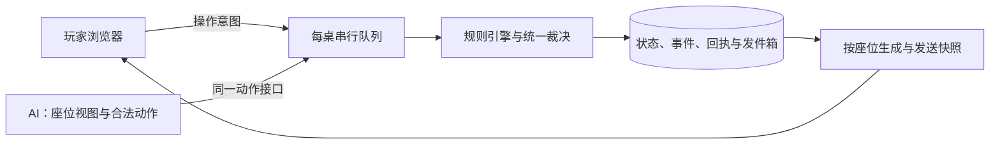
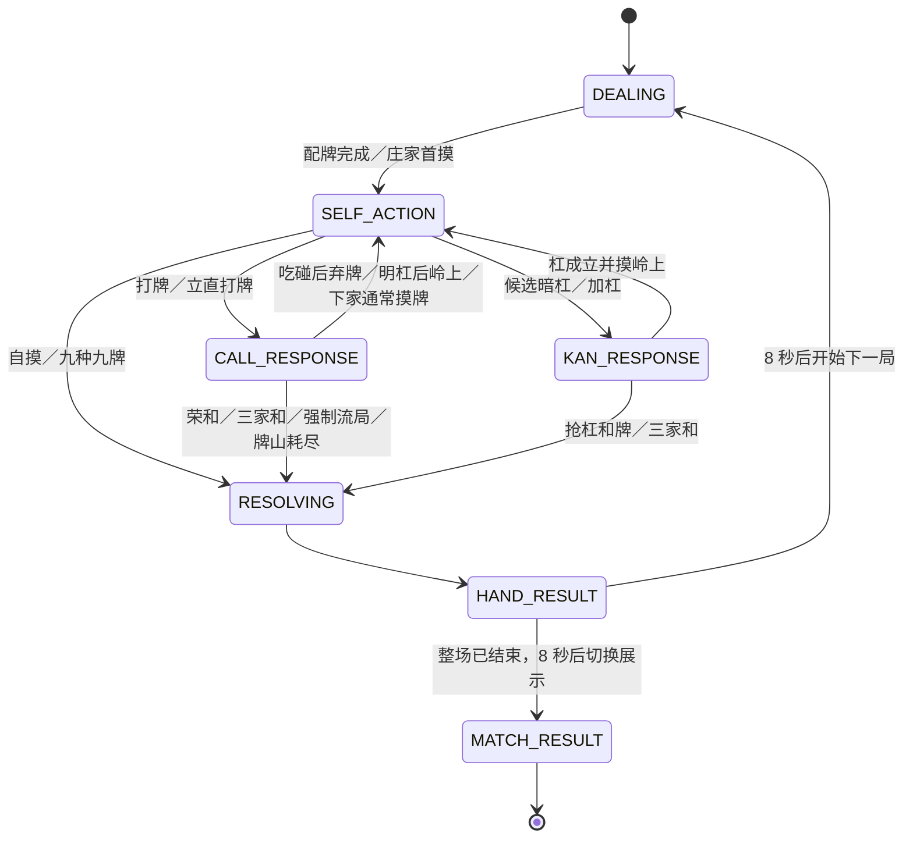
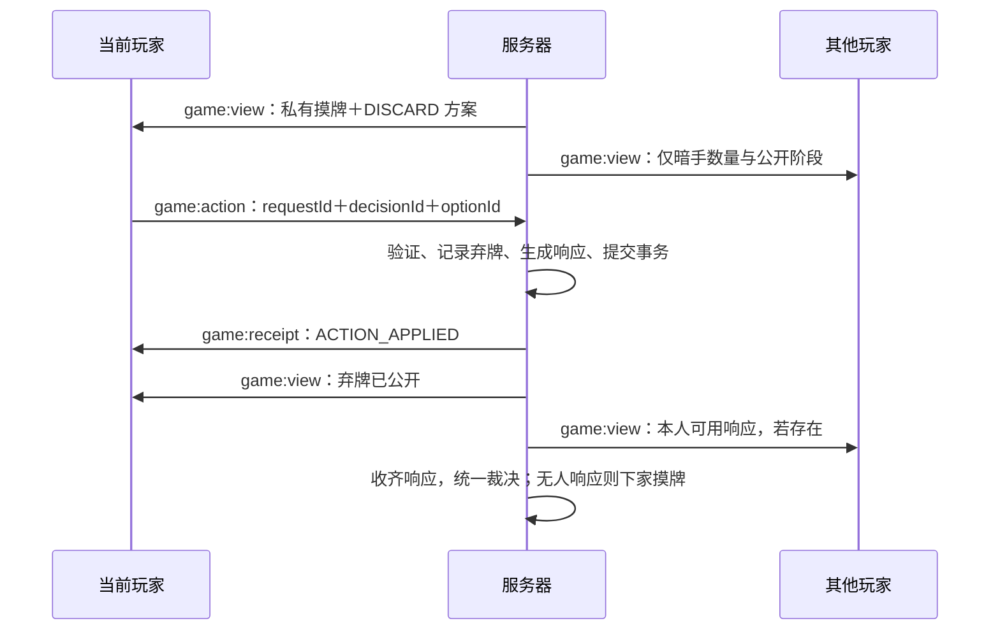

# 对局状态与通信协议 v1.0

文档日期：2026-10-28  
协议版本：`1.0`  
规则版本：`riichi-4p-v1.0`  
适用项目：网页多人日本麻将小游戏  
状态：开发规格；当前实现及验证结果见[《实现与验收记录》](历史/实现与验收记录.md)，本文消息示例本身不作为验收证据。

规则依据：[《日本麻将规则规格 v1.0》](日麻规则-v1.0.md)。役种、符数、振听、包牌、流局及终局以规则文档为准；本文确定这些规则如何表示为状态、动作与消息。

## 1. 架构与首版边界

采用服务器统一裁决。客户端只发送操作意图，服务器计算合法动作、收集响应、推进对局、结算并生成每个座位独立的可见状态。

首版使用 HTTPS 提供身份、房间和牌谱接口，Socket.IO 4.x 承载实时消息。Socket.IO 客户端与服务端必须成对使用；本文消息是其事件负载，不是原生 WebSocket 帧格式。

每桌只有一个逻辑写入者，所有玩家动作、AI 决策、截止事件、掉线和恢复事件进入同一串行处理队列。首版单服务进程管理多个房间，PostgreSQL 保存有效状态、事件、操作回执和待发送消息。以后扩容也必须保持一桌一个写入者。

首版采用**按座位投影的完整状态快照**，不实现前端增量补丁。麻将状态较小，以简单可靠的同步方式优先；以后更换传输方式时仍保留本文的权限、编号与幂等语义。

边界：四个固定座位、好友房、开场前 AI 补位、对局中掉线托管；不开放观战、中途换人或房间内连续开新场。一场结束后可以创建新房间。



### 1.1 必须遵守的原则

1. 客户端不能提交自己的点数、摸到的牌、下一家、役种、番符或和牌金额作为裁决依据。
2. 内部完整状态不能直接序列化给客户端，也不能广播到包含四名玩家的共享通道。
3. 对手手牌、未来牌山、未翻指示牌和未公开响应不得出现在其他座位的消息中。
4. 收到操作不等于鸣牌已经生效；响应必须先收齐，再统一裁决。
5. 合法动作由服务器给出，提交时仍须再次验证；客户端按钮和动画不是权限依据。
6. 操作与点数结算先持久化，再确认和推送。传输失败不能撤销已提交结果。
7. 重复传输可以发生，但一个有效操作最多改变一次状态。
8. 所有实际比赛都保存规则版本、协议版本和时限预设，回放不套用未来规则。

## 2. 编号、牌与基础数据约定

### 2.1 标识与序号

| 字段 | 含义与约束 |
| --- | --- |
| `roomId` | 房间唯一标识，服务器生成；邀请码不是授权凭据 |
| `matchId` | 一场东风战／半庄战的唯一标识 |
| `handId` | 一次实际配牌的唯一标识；同局号连庄也必须换 ID |
| `seat` | `0..3`，固定对应本场开局东、南、西、北位置，整场不变 |
| `dealerSeat` | 本局庄家所在固定座位；不能假定总是 seat 0 |
| `handIndex` | 本场配牌次数，从 1 开始；不是东一／东二的局号 |
| `windowId` | 当前操作或响应窗口 ID；每次新开窗口生成，恢复后可换新 |
| `decisionId` | 某座位在某窗口的不可变决策 ID，其他座位看不到 |
| `optionId` | 某次决策中的具体合法方案 ID，包括所用实体牌 |
| `requestId` | 客户端 UUID，用于一次逻辑请求；重发保持不变 |
| `receiptId` | 已落库回执的唯一标识 |
| `eventId` | 服务器内部事件 ID，供事件存储和牌谱引用 |
| `settlementId` | 一次完整单局结算的唯一标识，防止重复结算 |
| `streamId` | 某场比赛、某个查看座位的独立状态流 ID，重连保持不变 |
| `viewSeq` | 该状态流的单调递增安全整数；不是全桌共享序号 |
| `serverEpoch` | 每桌进程恢复／所有权迁移后递增，用于拒绝恢复前未提交的新动作 |
| `bindingId` | 当前人工控制连接的临时凭据，接管或重新绑定后更换 |

所有业务 ID 为不透明字符串，不根据字符串推断时间、座位、权限或顺序。JSON 中所有序号必须在 JavaScript 安全整数范围内；点数允许为负，但必须是整数。

时间戳使用 UTC Unix 毫秒数。用户界面按本地时区显示；服务器截止使用单调时钟调度，墙上时间仅用于传输与持久化恢复。

### 2.2 实体牌编码

```ts
type Seat = 0 | 1 | 2 | 3;
type Wind = "EAST" | "SOUTH" | "WEST" | "NORTH";
type MatchFormat = "EAST_ONLY" | "HANCHAN";
type TileId = number; // 整数 0..135
type TileKind = number; // 整数 0..33
type SeatVector<T> = [T, T, T, T]; // 索引始终为固定 seat
```

`kind = floor(tileId / 4)`；同种四张牌为 `4*kind` 到 `4*kind+3`。

| kind | 牌种 |
| --- | --- |
| 0..8 | 一万至九万 |
| 9..17 | 一筒至九筒 |
| 18..26 | 一索至九索 |
| 27..30 | 东、南、西、北 |
| 31..33 | 白、发、中 |

赤五固定为 `tileId = 16、52、88`，分别对应赤五万、赤五筒、赤五索。客户端可从公开牌 ID 推导牌种和赤色，但服务器绝不发送未知牌的 ID。

同种普通牌仍须使用实际实体 ID。立直摸切、食替、鸣牌消耗和牌谱都不能只记录牌种。牌 ID 的固定编码与洗牌顺序相互独立。

本局自风：`[EAST,SOUTH,WEST,NORTH][(seat - dealerSeat + 4) % 4]`。玩家下家为固定座位 `(seat + 1) % 4`，不受牌桌画面朝向影响。

### 2.3 JSON 与类型约定

本文 TypeScript 是契约说明；实施时须建立运行时 Schema，不能只依赖静态类型。字段单位、可空性、枚举和数组约束都是协议的一部分。

- 明确可空的已定义字段用 `null`；禁止使用 `undefined`、`NaN`、`Infinity`。
- 消息中不允许传 Date、Map、Set、BigInt 或可执行内容。
- 允许客户端忽略同一主版本内新增的展示字段；服务器拒绝请求中的未知操作字段。
- “只给自己”的数据通过独立 `self` 对象表达；对手对象根本没有隐藏手牌字段。
- 一切 ID 校验、数组长度、实体牌归属和相同实体重复使用均在服务器检查。

## 3. 房间、身份与连接

### 3.1 身份与房间位置

游客也必须有稳定的服务器身份 `userId`，使用同源、HttpOnly、Secure 会话 Cookie 认证。刷新页面恢复身份；Cookie 丢失不能靠昵称或邀请码找回原座位。

房间开场前使用 `slotId`（0..3）安排成员，开场事务中随机分配固定 `seat` 并保存映射。`slotId` 与 `seat` 是不同概念。AI 占一个 slot，开始后成为独立 BOT 座位；真人掉线托管仍是原 HUMAN 座位。

一个用户同时最多加入一个未结束的房间／比赛，不允许重复占位。至少一名真人、四个位置全部有成员、真人均准备、机器人配置有效时，房主才能开场。

房主只能在开场前增删机器人。配置或成员变化清除所有真人的准备状态。房主开场前离开时，房主转给加入最早的剩余真人；最后一名真人离开则关闭房间。断线本身不删除成员、不转移房主。

### 3.2 HTTP 接口

接口统一位于 `/api/v1`。变更请求使用会话认证、Origin／CSRF 校验及 `Idempotency-Key` UUID；同一身份同一 key 的请求体必须完全一致。规范化请求体与方法、路径一起参与去重。

| 方法与路径 | 用途／关键请求字段 |
| --- | --- |
| `POST /sessions/guest` | 创建游客会话，`displayName`；已有有效会话则返回本人 |
| `GET /me` | 本人身份及当前 roomId／matchId，可为空 |
| `POST /rooms` | 创建房间，`format`、`rulesetId`、`timePresetId` |
| `POST /rooms/join` | 加入好友房，`inviteCode` |
| `GET /rooms/{roomId}` | 仅成员读取房间视图 |
| `PUT /rooms/{roomId}/ready` | 设置本人 `ready`，附 `expectedRoomVersion` |
| `PUT /rooms/{roomId}/slots/{slotId}/bot` | 房主增加／配置 AI，`botLevel`、`expectedRoomVersion` |
| `DELETE /rooms/{roomId}/slots/{slotId}/bot` | 房主删除 AI，附 `expectedRoomVersion` 请求头 |
| `POST /rooms/{roomId}/start` | 房主开场，`expectedRoomVersion`；返回唯一 matchId |
| `POST /rooms/{roomId}/leave` | 开场前离开；开场后将本人设为持续托管并退出视图 |
| `GET /matches/{matchId}/requests/{requestId}` | 本人查询操作回执，不能查询其他人操作 |
| `GET /matches/{matchId}/replay` | 本场参与者在整场 FINISHED 后获取完整牌谱 |

开场后 leave 不释放座位，也不视为结束整场。再次附着比赛可申请恢复人工控制，但按窗口边界生效。整场 ABORTED 不提供正式全信息牌谱，可由参与者查看技术中止摘要；排障事件仅管理员可读。

HTTP 成功体为 `{ "data": ... }`；失败体为 `{ "error": { "code": "...", "message": "...", "retryable": false } }`，并使用适当的 400／401／403／404／409／429／503 状态。查询未知操作回执返回 404，语义是“尚无已提交记录”，不能据此断言原请求永远不会提交；应结合当前窗口和后续同步判断。

`roomVersion` 对开场前业务变更使用乐观并发校验；在线状态变化使用单独 `presenceVersion`，不使准备请求无故冲突。房间创建、加入、占位、开场使用事务与唯一约束，重发开场不得创建第二场。

### 3.3 Socket.IO 建连

- 传输路径：`/socket.io`；命名空间：`/game`；部署必须支持长连接。
- 握手 `auth`：`{ "protocolVersion": "1.0" }`，实际身份来自会话。
- 服务端检查协议兼容性、会话、Origin，并返回 `server:hello`。
- 一个身份同一时刻只有一个有效 binding 和一个私有牌桌订阅。第二个连接可完成握手，但在显式接管前不能附着私有牌桌；不得自动踢掉另一设备后立即出牌。
- 显式接管在服务器串行执行，旧 binding 和私有订阅失效，旧连接不能再提交动作或继续同步。Socket.IO 的 socket.id 不是身份或座位。
- 重连必须重新认证。首版不依赖 Socket.IO 自带的丢包恢复；以应用层完整快照恢复为准。

`server:hello` 字段：`protocolVersion`、`connectionId`、`serverTime`、`authenticatedUserId`、`supportedRulesetIds`。不附带对局暗手。

### 3.4 房间状态

| 状态 | 含义 | 允许的用户操作 |
| --- | --- | --- |
| `WAITING` | 开场前准备 | 加入、离开、准备、房主配置 AI／开场 |
| `PLAYING` | 已创建唯一比赛 | 附着比赛、对局动作、离开转托管 |
| `FINISHED` | 正常结束 | 查看成绩与牌谱 |
| `ABORTED` | 技术中止 | 查看中止摘要 |
| `CLOSED` | 未开场即关闭 | 无 |

房间视图包含房间配置、成员、房主、准备状态、roomVersion、presenceVersion 和 matchId，不包含比赛内部状态。开始事务同时完成座位分配、match 创建和 room 状态更新，不暴露半完成的 `STARTING` 状态。

```ts
interface RoomView {
  roomId: string;
  inviteCode: string;
  status: "WAITING" | "PLAYING" | "FINISHED" | "ABORTED" | "CLOSED";
  roomVersion: number;
  presenceVersion: number;
  roomViewSeq: number; // 包含成员／准备／在线状态的统一展示序号
  hostUserId: string;
  config: {
    rulesetId: "riichi-4p-v1.0";
    format: MatchFormat;
    timePresetId: "standard-v1";
  };
  slots: SeatVector<RoomMember | null>; // 此处索引是 slotId，尚非随机后的 seat
  matchId: string | null;
}

interface RoomMember {
  memberId: string;
  userId: string | null; // BOT 为 null；标识本身不授予任何权限
  displayName: string;
  participantKind: "HUMAN" | "BOT";
  ready: boolean;
  connected: boolean; // BOT 恒为 true
  botLevel: "STANDARD" | null; // 首版公开一种策略等级，真人为 null
}
```

room:view 同样按 roomViewSeq 丢弃旧帧，以免在线状态推送覆盖较新的准备结果。订阅时使用与比赛相同的原子“读取基线＋注册订阅”，并通过完整视图同步。机器人 ready 恒为 true；显示名是普通文本，不参与身份判断。

## 4. 服务器内部完整状态

完整状态只能存在于规则服务、受限数据库和排障工具中，不属于外部消息格式。

| 状态组 | 必须保存的内容 |
| --- | --- |
| 比赛 | matchId、规则／协议版本、赛制、时限预设、状态、初始座位映射、serverEpoch |
| 局面 | handId、handIndex、场风、局号 1..4、dealerSeat、本场、供托点数、延长标记 |
| 牌山 | 全部洗牌结果、固定配牌顺序、通常摸牌指针、末端指针、岭上顺序、补入牌、表里指示牌 |
| 每座位 | 暗手、单独的本次摸牌、面子、完整弃牌历史、点数、立直、振听、一发、首次摸切条件 |
| 杠 | 成功总数、各家杠数、候选杠、抢杠目标牌、待四杠流局标记、包牌责任者 |
| 窗口 | phase、windowId、截止、目标弃牌／候选杠、相关决策、合法方案、提交记录、窗口控制者 |
| 控制 | 原始真人／AI 身份、在线状态、期望控制方式、已生效方式、连接 generation、当前 binding |
| 结算 | settlementId、完整支付账本、翻里范围、和牌拆分、下一局计划、终局原因 |
| 一致性 | 内部 revision、内部 eventSeq、已提交回执、投影版本、事务发件箱、最近持久化位置 |

具体约束：

- 本次摸牌与原暗手分开存储，才能可靠实现摸切和立直后暗杠。打旧手牌时，把原摸牌并入暗手再移除弃牌。
- 面子保存 `meldId`、类型、所有实体牌、来源座位、来源弃牌、成功时间；加杠保留原碰的来源。
- 弃牌保存 `discardId`、座位、实体牌、是否摸切、是否声明立直、是否被鸣走及对应 meldId。历史不是当前实体牌的所有权容器。
- 立直状态至少区分 `NONE`、`DECLARED`、`ESTABLISHED`，另记单立直／双立直、一发状态及声明弃牌。
- 振听分别保存／计算舍牌振听、同巡振听、立直后见逃振听，不合并成一个不可追溯的布尔值。
- 候选加杠／暗杠只引用现有牌，抢杠结束前不正式移动牌、不加杠数、不翻宝牌。
- `pendingAbort` 可表示四风、四家立直、四杠等待和牌优先裁决的原因，不能直接跳过荣和。
- 每次实际配牌重新生成 handId，防止“东一零本场”和“东一一本场”的旧操作串入。

## 5. 对局状态机

比赛 `status` 为 `RUNNING | RECOVERING | FINISHED | ABORTED`。`phase` 表示当前局的步骤，两者含义不同。



### 5.1 各阶段

| phase | 可操作对象 | 合法动作范围 | 截止 |
| --- | --- | --- | --- |
| `DEALING` | 服务器 | 洗牌、配牌、翻初始指示牌 | 无玩家时限 |
| `SELF_ACTION`，`AFTER_DRAW` | 当前行动家 | DISCARD、RIICHI_DISCARD、TSUMO、ANKAN、KAKAN、ABORT_KYUUSHU | 15 秒 |
| `SELF_ACTION`，`AFTER_CALL` | 吃／碰者 | 仅合法 DISCARD，包含食替限制 | 15 秒 |
| `CALL_RESPONSE` | 有合法响应的其他座位 | PASS、RON、CHI、PON、DAIMINKAN | 统一 8 秒 |
| `KAN_RESPONSE` | 有抢杠机会的其他座位 | PASS、RON；暗杠仅国士 | 统一 8 秒 |
| `RESOLVING` | 服务器 | 计算并原子提交单局结果 | 无玩家动作 |
| `HAND_RESULT` | 无 | 展示结果，自动推进 | 8 秒 |
| `MATCH_RESULT` | 无 | 最终成绩与牌谱入口 | 无 |

DEALING、RESOLVING 可在一次原子推进中完成，不要求推送这些瞬时阶段。已关闭的窗口绝不因动画或客户端确认重新打开。

### 5.2 窗口与决策

一个窗口对应一个公开阶段，可能包含一个或多个座位决策。每个决策在创建时冻结：所属 handId、windowId、seat、合法选项、控制者和截止。其他人提交响应不使剩余决策失效。

只有 PASS 可选的座位由服务器自动记录过牌，不要求玩家手动点击，也不为其创建可提交决策；没有合法 RON 时自动过牌不新增见逃振听。至少有一种非 PASS 响应的座位同时得到同一窗口的完整 8 秒时限。

当前窗口没有仍能改变结果的未提交决策时可以提前结束；例如有人已碰，也仍要等待所有可能荣和者，包括可能使双响变三家和者。最稳妥的首版实现是等待全部相关决策完成或截止。

### 5.3 弃牌响应推进顺序

1. 在同一动作提交中移出实体弃牌、写入弃牌历史，必要时标记立直 `DECLARED`，但尚不收供托。
2. 基于此时状态生成其他座位的合法响应，收录选择；只有选择者本人看到自己的提交状态。
3. 关闭窗口后，计算所有合法 RON：三家和流局；一家／两家正常结算，取消本次未成立立直。
4. 无 RON 时使本次立直成立并扣款，之后检查已触发的强制途中流局。
5. 无流局则按规则优先级选择碰／明杠／吃，消费获选方案中的实体牌，取消一发。
6. 明杠直接正式成立、翻新指示牌、摸岭上；吃碰进入 AFTER_CALL；无人鸣牌则下家通常摸牌。
7. 牌山已空且不能继续时，检查流局满贯，然后才做普通荒牌结算。

每个本来可 RON 的人若选择非 RON（包括 CHI／PON／PASS 或超时），按规则更新其私有振听。未获选鸣牌不消费手牌；先收录的 PON 被后来的 RON 压过是正常结果。

### 5.4 杠的两阶段处理

ANKAN／KAKAN 被接受后生成候选杠并打开 KAN_RESPONSE，候选杠声明涉及的牌可公开展示，但尚未计为成功面子。无合法抢杠者时该逻辑阶段可立即结束。

加杠的可抢实体就是提交的第四张；暗杠的抢杠目标由合法方案预先固定：若本次摸牌属于这四张就选本次摸牌，否则选四张中 ID 最小者。该选择只用于实体账本，不能影响按牌种判定国士的资格。

有 RON 时执行抢杠结算，不翻新宝牌、不摸岭上、成功杠数不变；原碰保持。无 RON 才正式消费／升级面子，增加杠数、翻宝牌、取消一发、转移王牌补入牌并摸岭上。

第四杠分属多人时保存四杠散了待判标记，仍给岭上自摸与其后弃牌的荣和机会。不得在第四杠成立瞬间直接结算流局。

## 6. 发给客户端的完整视图

### 6.1 视图根结构

```ts
interface MatchView {
  matchId: string;
  rulesetId: "riichi-4p-v1.0";
  format: MatchFormat;
  timePresetId: "standard-v1";
  status: "RUNNING" | "RECOVERING" | "FINISHED" | "ABORTED";
  viewerSeat: Seat;
  players: SeatVector<PlayerPublicView>;
  hand: HandPublicView | null;
  self: SelfPrivateView;
  lastHandResult: HandResult | null;
  matchResult: MatchResult | null;
  abortReason: "TECHNICAL_FAILURE" | null;
}

interface PlayerPublicView {
  seat: Seat;
  displayName: string;
  participantKind: "HUMAN" | "BOT";
  connected: boolean;
  effectiveControl: "HUMAN" | "AI";
  points: number;
}

interface HandPublicView {
  handId: string;
  handIndex: number;
  roundWind: "EAST" | "SOUTH" | "WEST";
  roundNumber: 1 | 2 | 3 | 4;
  isExtension: boolean;
  dealerSeat: Seat;
  honba: number;
  kyotakuPoints: number; // 点数单位；不是立直棒根数
  phase: "DEALING" | "SELF_ACTION" | "CALL_RESPONSE" |
    "KAN_RESPONSE" | "RESOLVING" | "HAND_RESULT" | "MATCH_RESULT";
  activeSeat: Seat | null;
  liveWallRemaining: number;
  rinshanRemaining: number;
  successfulKanCount: number;
  doraIndicators: TileId[]; // 仅已经生效的表指示牌
  lastDiscard: (DiscardView & { seat: Seat }) | null; // 当前局最新的公开弃牌；新配牌归零
  seats: SeatVector<HandSeatPublicView>;
  window: PublicWindow | null;
  pendingKan: PendingKanView | null;
  resultDisplayUntil: number | null;
}

interface HandSeatPublicView {
  seat: Seat;
  seatWind: Wind;
  concealedCount: number; // 当前暗手实体数，含尚未打出的本次摸牌
  riichi: "NONE" | "DECLARED" | "ESTABLISHED";
  riichiKind: "SINGLE" | "DOUBLE" | null;
  riichiDiscardId: string | null;
  melds: MeldView[];
  discards: DiscardView[]; // 完整历史；被鸣走的条目仍存在
}

interface MeldView {
  meldId: string;
  type: "CHI" | "PON" | "ANKAN" | "DAIMINKAN" | "KAKAN";
  tiles: TileId[]; // 吃碰三张，杠四张；ANKAN 也保留赤牌身份
  sourceSeat: Seat | null;
  sourceDiscardId: string | null;
  calledTile: TileId | null; // 暗杠为 null；加杠仍指原碰牌
  addedTile: TileId | null; // 仅 KAKAN 非空
}

interface DiscardView {
  discardId: string;
  tile: TileId;
  tsumogiri: boolean;
  riichiDeclaration: boolean;
  claimedByMeldId: string | null;
}

interface PublicWindow {
  windowId: string;
  kind: "SELF_ACTION" | "CALL_RESPONSE" | "KAN_RESPONSE";
  actorSeat: Seat; // 行动家、原出牌者或杠声明者
  selfActionMode: "AFTER_DRAW" | "AFTER_CALL" | null;
  sourceDiscardId: string | null;
  deadlineAt: number;
}

interface PendingKanView {
  seat: Seat;
  type: "ANKAN" | "KAKAN";
  tiles: TileId[]; // 暗杠四张；加杠展示原碰及第四张
  baseMeldId: string | null;
  robbableTile: TileId;
}
```

暗杠在本项目中公开牌种和四张牌的赤色身份，画面仍可把外侧两张画成背面。未确认的候选杠单列，不伪装为已经成功的 meld。

`concealedCount` 不重复包含面子。弃牌历史中的被鸣走牌只是引用，不再占据牌河实体区域。自摸和牌后的摸牌仍属于该玩家牌区；荣和的完成牌不从来源牌区复制出第二张实体牌，而在结果中通过引用展示。

### 6.2 本人私有视图

```ts
interface SelfPrivateView {
  concealedTiles: TileId[]; // 不含下面单列的 drawnTile
  drawnTile: TileId | null;
  drawSource: "LIVE_WALL" | "RINSHAN" | "INITIAL" | null;
  furiten: { discard: boolean; temporary: boolean; afterRiichiPass: boolean };
  decision: DecisionView | null;
  desiredControl: "HUMAN" | "AI";
}

interface DecisionView {
  decisionId: string;
  windowId: string;
  owner: "HUMAN" | "AI";
  deadlineAt: number;
  canSubmit: boolean;
  disabledReason: "AI_OWNED" | "CONTROL_PENDING" | "ALREADY_SUBMITTED" | null;
  submittedRequestId: string | null;
  options: LegalOption[];
}

type LegalOption =
  | { optionId: string; type: "DISCARD"; tile: TileId }
  | { optionId: string; type: "RIICHI_DISCARD"; tile: TileId }
  | { optionId: string; type: "TSUMO" }
  | { optionId: string; type: "ABORT_KYUUSHU" }
  | { optionId: string; type: "ANKAN"; tiles: TileId[] }
  | { optionId: string; type: "KAKAN"; meldId: string; tile: TileId }
  | { optionId: string; type: "PASS" }
  | { optionId: string; type: "RON" }
  | { optionId: string; type: "CHI"; consumedTiles: TileId[] }
  | { optionId: string; type: "PON"; consumedTiles: TileId[] }
  | { optionId: string; type: "DAIMINKAN"; consumedTiles: TileId[] };
```

相同吃形但消耗赤五／普通五不同，必须生成不同 optionId；PON 消耗两张，CHI 两张，DAIMINKAN 三张。声明立直与所打实体牌是一个不可分割的 RIICHI_DISCARD 动作，不能先发“立直”再单独发“打牌”。

客户端提交 optionId，不能自行拼接一套 consumedTiles 来绕过规则。服务器保存 optionId 对应的真实方案并校验仍属于该决策。LegalOption 的牌字段用于展示和选择，不是客户端传回的新事实。

### 6.3 信息过滤表

| 数据 | 当前本人 | 其他对局玩家 | 整场结束后的参与者牌谱 |
| --- | --- | --- | --- |
| 本人暗手与摸牌实体 | 可见 | 不可见 | 可见 |
| 本人的合法动作、已提交选择 | 可见 | 不可见，直到最终裁决公开获选动作 | 记录最终动作与响应 |
| 振听、当前结构听牌 | 本人振听可见；听牌提示首版不提供 | 不可见；荒牌时公开听牌结果 | 可由完整状态复算 |
| 弃牌、面子、候选杠、表宝牌 | 可见 | 可见 | 可见 |
| 完整未来牌山、未翻表指示牌 | 不可见 | 不可见 | 可见 |
| 有效里指示牌 | 有立直和牌者出现后在结果中公开 | 同左 | 可见 |
| 其他未立直者暗手 | 不可见，除规则要求的和牌／荒牌公开 | 同左 | 可见 |
| 内部 revision、全局 eventSeq、其他决策 ID | 不下发 | 不下发 | 牌谱只按另定义的事件序列组织 |

实现投影必须使用明确白名单，禁止通过“复制完整对象再删几个字段”的方式处理。不得公开相关响应座位列表、他人提交数量或拒绝原因。普通游戏等待时长仍可能带来行为推测；首版不承诺抵抗所有时间侧信道。

## 7. 实时消息目录

除握手外，实时消息统一使用以下基础字段：

```ts
interface ClientEnvelope<T> {
  protocolVersion: "1.0";
  requestId: string;
  payload: T;
}
```

实时服务端消息带 `protocolVersion` 与 `serverTime`；有明确请求对应时带 requestId。Socket.IO ack 只是传输回调，业务上以落库的回执内容为准。

| 方向 | 事件 | payload／主要内容 |
| --- | --- | --- |
| C→S | `room:watch` | `{ roomId }`，仅成员可订阅；返回完整房间视图 |
| S→C | `room:view` | roomId、roomVersion、presenceVersion、完整成员视图与 matchId |
| C→S | `session:claim` | `{ takeover: boolean }`，获取或显式接管人工连接 |
| S→C | `session:claimed` | requestId、bindingId、当前控制资格 |
| C→S | `game:attach` | `{ matchId, bindingId, lastStreamId, lastViewSeq }`；游标可为 null |
| C→S | `game:sync` | `{ matchId, syncId }`；请求权威全量视图 |
| S→C | `game:view` | 见第 7.1 节，完整个人视图 |
| C→S | `game:action` | 见第 7.2 节，提交某个合法方案 |
| S→C | `game:receipt` | 见第 8 节，已落库的接受／拒绝回执 |
| C→S | `game:control` | `{ matchId, bindingId, mode: HUMAN或AI }`，申请下个窗口切换 |
| S→C | `server:notice` | code、message，例如 CONTROL_REVOKED／MATCH_RECOVERING；不含隐藏状态 |
| C→S | `time:ping` | `{ clientSentAt }` |
| S→C | `time:pong` | requestId、clientSentAt、serverReceivedAt、serverSentAt |

room:watch、session:claim、game:attach、game:sync、game:control 均必须返回对应 requestId 的成功响应或结构化失败；不能让请求无限等待。game:action 的响应统一为 game:receipt。其他请求可通过 Socket.IO ack 返回 `{ ok, requestId, data或error }`，状态推送随后独立到达。

session:claim 成功结果对同一 connection 与 requestId 去重，重发不得重复接管或轮换 binding；不同连接必须重新 claim。game:control 使用与动作相同的持久化去重机制，窗口切换请求不能通过重发延迟或提前生效。

### 7.1 game:view

```ts
interface ViewFrame {
  protocolVersion: "1.0";
  serverTime: number;
  matchId: string;
  serverEpoch: number;
  streamId: string;
  viewSeq: number;
  syncId: string | null; // 回应 attach 时使用其 requestId；回应 sync 时使用请求中的 syncId
  state: MatchView;
}
```

每个接收者收到自己的 state，不能把 A 的 self 放进发给 B 的消息。streamId 由服务器按 matchId＋固定 seat 绑定生成，不接受客户端指定读取他人流。

只有该座位可见 state 或 serverEpoch 发生变化时，其 viewSeq 才递增；serverTime、syncId 等发送元数据不触发版本增加。私下收录 A 的 PASS 可以更新 A 的 self，但不能让 B 因此收到新的序号或隐藏响应摘要。内部 eventSeq／revision 不复用为外部 viewSeq。

客户端规则：

1. 正常推送只应用同一流中 `viewSeq > 当前值` 的完整快照；较旧或重复帧忽略。
2. 跳号可直接应用较新的完整快照，不因缺少中间帧停牌；动画可简化，但不能猜测缺失动作。
3. attach／sync 的匹配 syncId 响应可用相同序号重新安装本地视图；若本地已经有更大序号，忽略该旧同步响应。
4. 接受新的流必须来自经过认证的 attach 完整响应，并清空旧流状态，不能把不同流的序号比较。
5. `serverEpoch` 更新后清除旧窗口可点击状态；在新视图安装前禁止提交动作。
6. lastHandResult 按 settlementId 去重展示；状态重装不能再次播放支付或修改本地点数。

点数等字段全部由 state 替换，不能既根据 delta 加点，又根据快照再加一次。

### 7.2 game:action

```json
{
  "protocolVersion": "1.0",
  "requestId": "a5346871-266b-4994-a434-5889fdde8406",
  "payload": {
    "matchId": "match_demo_01",
    "handId": "hand_demo_07",
    "serverEpoch": 1,
    "bindingId": "binding_demo_a",
    "windowId": "window_demo_39",
    "decisionId": "decision_demo_seat1_39",
    "optionId": "option_demo_discard_52",
    "lastSeenViewSeq": 86
  }
}
```

该示例中的 optionId 假设对应服务器已经提供的赤五筒弃牌方案。请求中没有 seat、分数、牌山或计分参数；seat 从身份与比赛成员关系推导。

`lastSeenViewSeq` 只用于排障，不能作为全桌状态版本锁。其他玩家响应、在线状态改变或自己的展示状态更新，不应让仍有效的 decisionId 变成过期请求。

服务器验证顺序：认证与成员资格 → 当前连接控制资格 → 已有回执／同 ID 冲突 → 协议和载荷校验 → serverEpoch → 比赛与 handId → windowId／decisionId → 控制者与截止 → optionId／实体归属／规则复核 → 事务提交。

读取已有回执时，只验证查询者身份与回执归属，不要求原窗口仍有效；已成功的旧动作重发应返回原结果。bindingId、lastSeenViewSeq 不参与逻辑动作的内容哈希，其他动作标识均参与；重连后的新 binding 因而可以查询或重发同一逻辑动作。失效连接自身仍不能读取或提交控制请求。

## 8. 回执、幂等与竞态

### 8.1 接受回执

```json
{
  "protocolVersion": "1.0",
  "serverTime": 1793156400123,
  "requestId": "a5346871-266b-4994-a434-5889fdde8406",
  "matchId": "match_demo_01",
  "receiptId": "receipt_demo_210",
  "status": "ACCEPTED",
  "acceptance": "ACTION_APPLIED",
  "decisionId": "decision_demo_seat1_39"
}
```

`acceptance` 枚举：

- `ACTION_APPLIED`：该自行动作已作为有效输入提交。例如弃牌已经产生，但其后的鸣牌和和牌还未裁决。
- `RESPONSE_RECORDED`：PASS／RON／CHI／PON／DAIMINKAN 已收录，仅保证选择有效且不可修改；最后可能因优先级失去执行机会。

上例对应第 7.2 节弃牌请求。若请求选择的是响应窗口的碰牌方案，则返回 RESPONSE_RECORDED；回执不包含“碰已经成功”这种未经统一裁决的结论。

客户端收到 ACCEPTED 后禁用重复选择，最终画面以 game:view 为准。即使回执先到、快照后到也不能自行消费手牌；若快照先到，不能因回执延迟恢复旧按钮。

### 8.2 拒绝回执

```json
{
  "protocolVersion": "1.0",
  "serverTime": 1793156400250,
  "requestId": "ff786cf2-2a59-4baa-9cf5-e7bdbed55522",
  "matchId": "match_demo_01",
  "receiptId": "receipt_demo_211",
  "status": "REJECTED",
  "error": {
    "code": "WINDOW_EXPIRED",
    "message": "本次操作时间已结束",
    "retryable": false,
    "shouldSync": true
  }
}
```

身份未通过、载荷无法解析或请求未进入持久化处理时，可能只有即时错误且无 receiptId。客户端不能把“未收到回执”当作被拒绝；必须查询或同步。

### 8.3 持久化去重

去重键为 `(matchId, actorIdentity, requestId)`；真人 actorIdentity 来自身份，AI／超时来自受信任的内部执行者。保存规范化动作哈希与回执。

- 相同键、相同逻辑动作：返回原回执，不重新执行，不重新验证已经结束的窗口。
- 相同键、不同逻辑动作：`REQUEST_ID_CONFLICT`，绝不覆盖旧记录。
- 同一 decisionId 两个不同 requestId：第一个成功提交的决策保留，第二个 `DECISION_ALREADY_SUBMITTED`；不是“最后一次选择生效”。
- 确定性的业务拒绝也保存回执；容量限流、数据库临时不可用等尚未提交的错误可标记 retryable。
- decision 收录、事件、状态更新、回执、可见投影序号和发件箱在同一数据库事务中提交。
- 服务进程在提交后、发消息前崩溃，恢复后仍返回已接受回执并补发最新视图。

回执至少保留至比赛结束后七天；与比赛事件采用一致保留策略。实时游标与确认不是去重数据库的替代品。超过保留期限不允许把旧 matchId 的动作当新动作重新执行。

### 8.4 截止与超时竞争

截止以经过身份校验、进入每桌唯一接入队列的服务器接收时间为准；客户端时间、发包时间和动画时间不作为依据。实际比较使用 `receivedMono < deadlineMono`；恰好相等也算超时。deadlineAt 是该截止的墙上时间表示，用于客户端展示；系统墙上时间校准不能使已经过期的窗口重新有效。

该接入队列同时排列输入与截止事件。处理截止事件前必须先处理所有已在截止前入队的消息，不能因数据库处理较慢而误判这些消息超时。截止后的消息不得因为计时器回调延迟而被接受。

超时是同一队列中的受信任内部动作，使用稳定 ID，例如按 matchId＋decisionId 派生；与真人动作竞争同一个决策提交约束。二者只能有一个成功。客户端无权伪造 INTERNAL_TIMEOUT 或 AI 身份。

自行动作超时按规则摸切／食替后合法最小实体 ID 弃牌；响应超时记 PASS；不自动立直、杠或九种九牌。在线玩家放弃自摸而超时弃牌的行为保持规则文档约定。

## 9. 错误码

| code | 含义 | 客户端动作 |
| --- | --- | --- |
| `UNAUTHENTICATED` | 会话缺失／失效 | 重新认证，不自动创建另一身份冒充原座位 |
| `FORBIDDEN` | 非本人资源或无权限 | 停止请求；不返回他人暗手或内部状态 |
| `PROTOCOL_UNSUPPORTED` | 协议主版本或必需能力不兼容 | 提示刷新／更新 |
| `INVALID_PAYLOAD` | 格式、枚举、字段或大小错误 | 修正请求，不自动循环重试 |
| `ROOM_VERSION_CONFLICT` | 开场前房间版本已变化 | 重取房间视图 |
| `ROOM_NOT_READY` | 不满足开场条件 | 按房间视图展示 |
| `CONTROL_IN_USE` | 另一连接控制中 | 提供明确接管入口 |
| `CONTROL_REVOKED` | 本 binding 已失效 | 禁止操作，重新 claim |
| `CONTROL_PENDING` | 人工／AI 切换尚未到窗口边界 | 等新决策 |
| `MATCH_NOT_RUNNING` | 已结束或技术中止 | 同步并展示结果 |
| `MATCH_RECOVERING` | 服务恢复中 | 暂停操作、等待新快照 |
| `EPOCH_STALE` | 请求来自恢复前的 incarnation | 同步，不把旧选择自动套到新窗口 |
| `HAND_MISMATCH` | 请求所属配牌已结束 | 同步当前局 |
| `WINDOW_EXPIRED` | 窗口已关或截止已到 | 同步，不能新建 ID 强行重试 |
| `DECISION_NOT_OWNED` | 决策不属于本人或当前控制者 | 禁止操作 |
| `DECISION_ALREADY_SUBMITTED` | 同一决策已有最终选择 | 读取本人回执／快照 |
| `OPTION_NOT_AVAILABLE` | 方案不属于当前合法列表 | 同步或选择仍有效的合法方案 |
| `REQUEST_ID_CONFLICT` | 同一请求 ID 被改成其他动作 | 停止该请求，保留原回执 |
| `REPLAY_NOT_AVAILABLE` | 尚未正常结束，或无访问权 | 不轮询下载隐藏数据 |
| `RATE_LIMITED` | 超过服务限流 | 按 retryAfterMs 退避 |
| `TEMPORARY_UNAVAILABLE` | 未提交的服务临时故障 | 退避后同 ID 查询／重试 |

`message` 仅供展示，逻辑按 code 分支。错误不能向其他玩家公开“某人正听三六万”“某人拒绝荣和”等私有原因。

## 10. 单局结果、点数账本与整场结果

### 10.1 单局结果

```ts
type HandEndReason = "TSUMO" | "RON" | "NAGASHI_MANGAN" | "EXHAUSTIVE_DRAW" |
  "ABORT_KYUUSHU" | "ABORT_FOUR_WINDS" | "ABORT_FOUR_RIICHI" |
  "ABORT_FOUR_KANS" | "ABORT_TRIPLE_RON";

interface HandResult {
  settlementId: string;
  handId: string;
  reason: HandEndReason;
  wins: WinDetail[]; // RON 可两项；三家和必须为空
  tenpaiSeats: Seat[] | null; // 仅普通荒牌非 null，含空数组
  revealedHands: RevealedHand[];
  revealedUraIndicators: TileId[];
  pointsBefore: SeatVector<number>;
  kyotakuBefore: number;
  transfers: PointTransfer[];
  delta: SeatVector<number>;
  pointsAfter: SeatVector<number>;
  kyotakuAfter: number;
  nextHand: NextHandPlan | null;
  matchEndReason: MatchEndReason | null;
}

interface WinDetail {
  winnerSeat: Seat;
  sourceSeat: Seat | null; // TSUMO／NAGASHI 为 null
  winningTile: TileId | null; // NAGASHI 为 null
  method: "TSUMO" | "RON" | "NAGASHI_MANGAN";
  yaku: { yakuId: string; han: number; yakumanMultiplier: number }[];
  fu: number | null; // 天然役满／NAGASHI 为 null
  fuDetails: { code: string; value: number; meldId: string | null }[];
  han: number | null; // 天然役满／NAGASHI 为 null
  yakumanMultiplier: number; // 天然倍数；普通累计役满通过 limit 表示
  limit: "NONE" | "MANGAN" | "HANEMAN" | "BAIMAN" |
    "SANBAIMAN" | "KAZOE_YAKUMAN" | "YAKUMAN";
  dora: { omote: number; ura: number; aka: number };
  basePoints: number;
  decomposition: { kind: "STANDARD" | "CHIITOITSU" | "KOKUSHI"; groups: TileId[][] } | null;
  pao: { yakumanId: "DAISANGEN" | "DAISUUSHII"; responsibleSeat: Seat }[];
}

interface RevealedHand {
  seat: Seat;
  concealedTiles: TileId[];
  drawnTile: TileId | null;
  winningTile: TileId | null; // 仅引用，不生成第二张实体牌
}

interface PointTransfer {
  transferId: string;
  from: Seat | "KYOTAKU";
  to: Seat | "KYOTAKU";
  amount: number; // 正整数，100 的倍数
  reason: "HAND_VALUE" | "HONBA" | "NOTEN" | "RIICHI_DEPOSIT" |
    "KYOTAKU_AWARD" | "FINAL_KYOTAKU";
  winnerSeat: Seat | null;
  yakumanId: string | null; // 包牌拆项时标识对应天然役满
}

interface NextHandPlan {
  roundWind: "EAST" | "SOUTH" | "WEST";
  roundNumber: 1 | 2 | 3 | 4;
  dealerSeat: Seat;
  honba: number;
  kyotakuPoints: number;
  isExtension: boolean;
}

type MatchEndReason = "BANKRUPTCY" | "DEALER_AGARI_YAME" |
  "DEALER_TENPAI_YAME" | "SCHEDULE_COMPLETE" |
  "EXTENSION_TARGET_REACHED" | "EXTENSION_HARD_LIMIT";
```

普通 yaku 项填写正 han、yakumanMultiplier=0；天然役满项相反。普通 han 包含普通役与全部有效宝牌，dora 字段为其中宝牌的分类明细，不能再加第二遍。天然役满的 dora 明细归零以表明不参与计分。累计役满的 yakumanMultiplier=0，limit=KAZOE_YAKUMAN。

yakuId 的首版稳定枚举如下；组合与替代关系按规则文档计算。未来同主版本新增的未知 yakuId 可用名称回退展示，但客户端始终不能据此重算支付。

| 枚举 | 对应役 |
| --- | --- |
| RIICHI、DOUBLE_RIICHI、IPPATSU、MENZEN_TSUMO | 立直、双立直、一发、门前清自摸和 |
| TANYAO、PINFU、IIPEIKOU | 断幺九、平和、一杯口 |
| YAKUHAI_WHITE、YAKUHAI_GREEN、YAKUHAI_RED | 白、发、中 |
| YAKUHAI_SEAT_WIND、YAKUHAI_ROUND_WIND | 自风、场风，重合时分别列两项 |
| HAITEI、HOUTEI、RINSHAN、CHANKAN | 海底、河底、岭上、抢杠 |
| CHIITOITSU、TOITOI、SANANKOU、SANKANTSU | 七对子、对对和、三暗刻、三杠子 |
| SANSHOKU_DOUKOU、SANSHOKU_DOUJUN、ITTSUU | 三色同刻、三色同顺、一气通贯 |
| CHANTA、HONROUTOU、SHOUSANGEN、RYANPEIKOU | 混全带幺九、混老头、小三元、两杯口 |
| JUNCHAN、HONITSU、CHINITSU | 纯全带幺九、混一色、清一色 |
| KOKUSHI、SUUANKOU、DAISANGEN | 国士无双、四暗刻、大三元 |
| SHOUSUUSHII、DAISUUSHII、TSUUIISOU | 小四喜、大四喜、字一色 |
| CHINROUTOU、RYUUIISOU、CHUUREN | 清老头、绿一色、九莲宝灯 |
| SUUKANTSU、TENHOU、CHIIHOU | 四杠子、天和、地和 |

宝牌不放进 yaku 列表，单独用 dora 计数；流局满贯由 reason／method 表示，yaku=[]。fuDetails 的 code 限于 BASE、CLOSED_RON、TSUMO、MELD、PAIR、WAIT、OPEN_MINIMUM、ROUNDING、FIXED_CHIITOITSU、FIXED_PINFU_TSUMO。固定符形只给固定项；其他形的各项 value 合计必须等于 fu，进位差额单列 ROUNDING。非面子项 meldId=null；天然役满／流局满贯 fuDetails=[]。

decomposition 的 groups 表示选定完成形：普通形包含面子与雀头，杠保留四张；七对子七组对子；国士以十三种牌分组。一张和牌引用只能计入一个组。NAGASHI 不存在完成形，置 null。

### 10.2 账本边界

pointsBefore／kyotakuBefore 是本次关局事务前的值；之前已成立并扣除的立直棒已包含在该起点内，不在结果中再扣一次。若关局事务同时处理第四家立直成立，其 RIICHI_DEPOSIT 进入本次 transfers。

逐条 transfers 推导 pointsAfter 与 kyotakuAfter，并计算 delta。必须满足：

- `pointsAfter[s] = pointsBefore[s] + delta[s]`。
- `sum(delta) + kyotakuAfter - kyotakuBefore = 0`。
- 任一时点 `sum(points) + kyotakuPoints = 100000`。
- KYOTAKU→KYOTAKU、自付自己、零／负金额均不允许；双响供托只发一次。

流局满贯多家相互支付用多条转账保留来源，展示可合并净额，不能丢失原始账本。包牌按役满项拆分；本场按规则指定付款人，不能平均分摊全部复合役满。

### 10.3 整场终局

先完成双响、包牌、本场、罚符和供托处理，再按规则文档判断飞人及终局；不能在第一笔转账出现负分时中途停止。

结算决定终局时，在同一事务中清算最终供托、固定最终名次并将 status 标为 FINISHED。最终供托作为 FINAL_KYOTAKU 进入同一次 HandResult 账本，再生成 MatchResult，不另执行第二次加点。

```ts
interface MatchResult {
  matchId: string;
  reason: MatchEndReason;
  finalPoints: SeatVector<number>;
  ranks: SeatVector<1 | 2 | 3 | 4>;
  netPoints: SeatVector<number>;
  replayAvailable: boolean;
}
```

ranks 按固定 seat 索引，且必须为 1..4 的排列。净得失为最终点数减 25,000。下一局不再存在时 nextHand=null。

HAND_RESULT 中就可带最终 MatchResult，八秒后切换 MATCH_RESULT 只是展示阶段，不再判断胜负、改点或重复写入战绩。普通下一局则保留 lastHandResult，直到下一次关局结果替换，便于重连后查看上一局。

只按规则公开手牌：一般和牌公开和牌者；普通荒牌公开所有听牌者；途中流局不自动公开全员手牌；流局满贯按和牌者公开。存在已立直和牌者时才公开有效里指示牌；双响的未立直者也不能因此得到里宝牌番数。

## 11. 断线、托管、多连接与重连

### 11.1 窗口控制者固定

HUMAN／AI 的切换只在新操作窗口创建时决定，已开启窗口不换决策执行者。每个响应座位各有自己的控制者，不能因为别家掉线改变整桌控制。

真人掉线：不延长当前截止；当前尚未完成的 HUMAN 决策按原规则超时弃牌／PASS，标记当前决策暂不可由新连接提交；之后新窗口由托管 AI 操作。若掉线前动作已经提交，保留原选择。

重连后本人看到自己的暗手与窗口状态，人工恢复在下一个新窗口生效。当前是 AI 的窗口由 AI 完成；当前是掉线前遗留但尚未截止的 HUMAN 窗口也不因为重连重开，按原截止处理。该行为是规则文档“窗口边界恢复”的具体实现约定。

主动申请 AI／HUMAN 与主动 leave 同样改变 desiredControl，不能取消已收录的选择。AI 进程超时也走同一默认超时规则，不能让牌局永久挂起。

显式多设备接管是同一真人连接的原子替换，不修改规则状态或决策选择；原连接仍在线时，接管后的新连接可继续其尚未提交的 HUMAN 决策，旧 binding 立即失效。真正断线后已经标记 CONTROL_PENDING 的决策不能用接管绕过恢复边界。

### 11.2 重连流程

1. 恢复同一会话，握手并接收 server:hello。
2. session:claim 获取新的 binding；若另一控制连接仍有效则由用户显式选择接管。
3. game:attach 提交 matchId 与可选游标，服务器校验成员并发送完整个人视图。
4. 安装最新快照，按 decision 状态决定能否操作，不根据断线前按钮恢复点击。
5. 对断线前未获回执的 requestId 查询；已提交则使用原回执，未知且窗口已变则放弃旧选择并重新等待新决策。

原动作在服务器仍可能排队时，同 ID 重发也只会提交一次。重连后不得给旧动作分配新 requestId 盲目重试，更不得自动把旧 optionId 用到新窗口。

客户端可以保存 matchId、游标、尚未获回执的请求体与 requestId；不把这些信息当授权。bindingId 不作为永久恢复令牌，登出或身份改变时清理个人牌桌缓存。

### 11.3 同步屏障

attach 时，服务器在每桌队列中取得一致快照并建立该连接订阅。先发送基线，再发送该点之后的投影；不能先订阅再发送一个较旧快照覆盖新状态，也不能在“取快照／开始订阅”的间隙漏掉消息。

实现上通过队列内原子“读基线＋注册订阅”与有序发件箱完成。重复发件允许，客户端用 streamId／viewSeq 忽略；状态丢失时 game:sync 始终可获取最新全量视图。

## 12. 服务重启与持久化恢复

### 12.1 事务与发件箱

至少持久化以下数据：比赛当前完整状态、完整事件（含已提交私有响应）、回执、各座位投影及其 viewSeq、待发送发件箱、窗口控制者与超时设置。

每个有效动作事务流程：

1. 取得该桌写入资格与内部 revision，检查唯一 requestId／decision 提交约束。
2. 基于当前状态计算事件与新状态；自动推进到稳定可操作窗口或结果阶段。
3. 原子保存状态、事件、回执、投影变化及发件箱。
4. 提交事务后发送业务回执和按座位视图。发送失败保留发件箱或等待下一次完整同步。

不要求每张牌都重新创建数据库连接，但必须保证响应收录、关局和开场的事务边界。分布式锁之外仍需数据库 revision／所有权 generation 校验，防止旧进程继续写入。

### 12.2 恢复规则

- 恢复时先进入 RECOVERING，拒绝新的比赛动作；连接可保持但按钮禁用。
- 从持久化状态与事件恢复，验证实体牌与点数守恒，保留所有已收录响应和已完成结算。
- serverEpoch 增加；未完成窗口更换 windowId，未提交座位生成新 decisionId／optionId。已提交响应仍参与原目标的最终裁决，不能重新选择。
- 恢复后的已提交座位 self.decision 置 null，其原选择仍在内部保留，可用原 requestId 查询本人回执；仅未提交座位收到新决策，避免旧 decisionId 与新 windowId 混用。
- 恢复后为剩余未提交决策重发完整 15／8 秒时限；若已无需要等待的决策则直接继续裁决。局间展示恢复时重置八秒展示时间。此项只适用于服务恢复，普通网络掉线绝不加时。
- 旧进程计时器、AI 回调、旧 epoch 新提交全部失效；旧 requestId 的已提交回执仍可按归属查询。
- 更新后的状态、投影和 deadline 先提交，再恢复 RUNNING 并推送个人全量快照。
- 已 FINISHED 的比赛恢复只读取成绩，不重新执行终局供托或战绩写入。

恢复不了时 status=ABORTED、abortReason=TECHNICAL_FAILURE，room 同步为 ABORTED，不提供 MatchResult，不写有效名次。已经保存的点数仅作为中止时状态，不是正式成绩。

## 13. AI 接口与牌谱

### 13.1 AI 决策接口

```ts
interface BotInput {
  rulesetId: "riichi-4p-v1.0";
  view: MatchView; // 必须是对应座位的投影
  decisionId: string;
  deadlineAt: number;
}

interface BotOutput {
  decisionId: string;
  optionId: string;
}
```

BotRunner 只收到受限 BotInput，不能持有指向内部 MatchState 的对象引用。返回动作由服务器内部网关补齐 match／hand／window／epoch、受信任 actorIdentity 与稳定 requestId，再走同一决策校验和事务链。

AI 不能调用跳过振听、直接设点、重洗牌等特权接口。迟到的 AI 输出按过期处理；它与超时默认动作竞争同一个 decision 提交约束。随机策略种子与模型版本可在内部记录以便复现，不作为玩家可见字段。

### 13.2 牌谱契约

整场正常结束后，参与者可以读取牌谱。导出顶层字段：replayVersion、protocolVersion、rulesetId、format、timePresetId、初始座位、初始点数、各 hand、最终结果。

每手包含完整洗牌与配牌／王牌布局、按序事件、决策提交与裁决结果、结算账本。事件记录服务器顺序，明确区分 DRAW、DISCARD、RIICHI_DECLARED、RIICHI_ESTABLISHED、RESPONSE_RECORDED、CALL_RESOLVED、KAN_PROPOSED、KAN_COMMITTED、DORA_REVEALED、HAND_SETTLED、MATCH_FINISHED、CONTROL_CHANGED、RECOVERED。

牌谱不包含会话 Cookie、bindingId、请求认证信息或其他用户隐私。内部事件格式另设版本；公开牌谱不直接导出数据库对象。规则回放模式消费已记录事件，不重新随机洗牌，也不要求 AI 再次生成完全相同的决策。

比赛未结束时，完整牌谱接口必须拒绝；任何逐局查询或缓存下载地址也不得绕过这一限制。正常结束后的链接仍校验成员身份，不能仅凭 matchId 下载。

## 14. 端到端时序示例

### 14.1 普通摸切



### 14.2 碰被荣和压过

甲弃牌；乙先提交 PON，得到 RESPONSE_RECORDED；丙随后提交 RON。服务器仍等待其他可能荣和者，之后统一确定结果。若只有丙荣和，乙的两张牌原封不动，丙获得和牌；乙客户端不得因为先收到回执而先扣两张手牌。

### 14.3 双响与三家和

两人提交 RON 后，第三人仍可合法 RON 时必须继续等待。第三人 PASS 则双响；第三人 RON 则三家和途中流局。供托、本场、飞人只在窗口关闭后的一个关局事务中处理。

### 14.4 回执丢失

服务器已提交弃牌但回执丢失；客户端以相同 requestId 和逻辑动作重发。服务器返回原 receiptId，不再弃牌。即使此时已是下一家，返回原 ACCEPTED 仍正确，最新牌桌由快照说明。

## 15. 协议与实现验收清单

这些是待实现的验收条件，不表示测试已运行通过。规则结果另覆盖《日麻规则》的 R01～R48。

| 编号 | 场景 | 预期 |
| --- | --- | --- |
| P01 | 四家开场并旋转桌面 | 固定 seat 不变，自风由 dealerSeat 推导正确 |
| P02 | 自己摸牌时抓取四家消息 | 只有本人包含摸牌实体 ID |
| P03 | A 私下 PASS | 其他人无 A 的回执、提交状态、私有序号变化 |
| P04 | 相同吃形可消耗赤五或普通五 | 不同 optionId，准确消费指定实体 |
| P05 | 同一弃牌碰先到、荣和后到 | 碰仅收录，最终荣和优先 |
| P06 | 两家 RON，第三家仍有 RON | 不提前结双响，等待第三家选择／超时 |
| P07 | 同一请求重复十次 | 同一 receiptId，一次有效状态变更 |
| P08 | 同一 requestId 更换 optionId | REQUEST_ID_CONFLICT，原记录不变 |
| P09 | 同一 decision 两个不同 requestId | 只有首个成功提交的选择生效 |
| P10 | 其他人响应导致内部 revision 改变 | 本人尚有效的 decision 不因旧 viewSeq 被拒绝 |
| P11 | 截止前入队但处理延迟 | 仍按入队时间判有效，不被计时器抢先替代 |
| P12 | 截止相等或之后到达 | 超时，不因计时器调度延迟获得额外时间 |
| P13 | 真人操作与超时／AI 同时提交 | 同一决策只有一个成功 |
| P14 | 快照先于回执到达 | 不恢复旧按钮、不重复扣牌或加点 |
| P15 | 重复、较旧、跳号完整快照 | 重复旧帧忽略，新完整帧可直接安装 |
| P16 | attach 同时发生新动作 | 基线与后续推送无同步空隙，不用旧快照覆盖新状态 |
| P17 | 对手伪造其他 decision／stream／seat | 拒绝，且不返回其他暗手与合法动作 |
| P18 | 旧 binding 在设备接管后发动作 | CONTROL_REVOKED，无状态修改 |
| P19 | 立直声明牌被荣和 | 不收声明立直棒，结果与规则 R17 一致 |
| P20 | 加杠被抢 | 原碰保留，无新宝牌、无岭上、无成功杠计数增加 |
| P21 | 私有响应已落库，发送前服务崩溃 | 恢复保留响应，查询原回执，不要求重选 |
| P22 | 关局提交后发件箱尚未发送即重启 | 不重复结算，补发当前完整视图 |
| P23 | 重启时部分人未响应 | 新 epoch／窗口／截止；已提交者不重选 |
| P24 | 旧进程 AI 回调与恢复后动作并发 | 旧 epoch 写入被阻止 |
| P25 | 玩家在响应窗口中掉线再连接 | 不加时，当前遗留决策按原截止处理，后续窗口恢复人工 |
| P26 | AI 窗口中真人申请恢复 | 当前 AI 完成，下个新窗口人工 |
| P27 | 双响第一笔导致负分 | 仍结完全部支付，之后判断飞人 |
| P28 | 最终供托清算与结果阶段切换 | 只发一次供托，八秒展示不重复改点 |
| P29 | 多家流局满贯 | 账本保留相互付款，净额与规则一致 |
| P30 | 开场请求重复或并发 | 只有一个 matchId、一次座位随机分配 |
| P31 | 比赛未结束请求完整牌谱 | 拒绝；缓存／其他接口也不泄漏隐藏牌 |
| P32 | 技术中止 | 无正式 MatchResult、无有效名次和战绩 |
| P33 | 手牌、面子、牌山做所有权检查 | 每张实体牌恰好处于一个当前归属区域；历史引用不重复计数 |
| P34 | 每次支付与最终结果 | 点数＋供托恒为 100,000；最终供托清零 |
| P35 | 新协议主版本连接旧服务 | 明确拒绝，不静默使用不兼容格式 |
| P36 | 游戏重连已更新绑定后查询旧动作 | 可返回本人原回执，不能借此修改旧选择 |

## 16. 版本、实施顺序与参考

协议主版本变化用于不兼容字段、动作或同步语义；同一主版本可增加不影响旧客户端的展示字段。规则变更单独提升 rulesetId，不能只改协议号。持久化事件和牌谱也各自保留格式版本。

推荐实施顺序：基础类型和运行时 Schema → 无网络状态机与固定牌山 → 个人投影与保密测试 → 动作去重／事务 → Socket.IO 同步与重连 → AI 接口 → 崩溃恢复和牌谱。

参考资料（核对日期：2026-10-28）：

- [本项目日麻规则](日麻规则-v1.0.md)：所有合法性、计分和终局的依据。
- [Socket.IO 消息送达保证](https://socket.io/docs/v4/delivery-guarantees/)：默认送达保证不足以代替持久化去重与同步；本文据此在业务层规定回执和事务。
- [Socket.IO 连接状态恢复](https://socket.io/docs/v4/connection-state-recovery/)：自动恢复并非总能成功；本文首版统一采用应用层完整快照。
- [Socket.IO 连接中间件](https://socket.io/docs/v4/middlewares/)：握手认证只是入口，实际动作仍必须校验成员与控制权。

本规格定义开发目标，没有创建实际后端、数据库、AI 或可运行的接口。

### 2026-10-29：行动节奏与来源提示

AI 自行行动展示等待为 2,000ms，弃牌／抢杠响应为 1,200ms，使用现有窗口的单调时钟定位执行时间；计算与展示等待分别计时，过期／旧窗口／旧 epoch 的回调不提交。不改变真人 15 秒、响应 8 秒时限，也不因动画延长截止。

hand.lastDiscard 是新增公开展示字段，仅从当前局已产生的 DISCARD 及对应公开弃牌记录构造，不暴露内部事件序号、他人选择、暗手或未来牌。鸣牌后更新 claimedByMeldId，进入下一局时置 null；响应来源始终由当前 window.sourceDiscardId 或候选杠确定，不能用全局最新牌代替。
