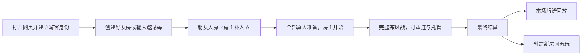

# 首版功能范围 v1.0

文档日期：2026-10-28  
产品版本：`MVP 1.0`  
适用项目：网页多人日本麻将小游戏  
规则版本：`riichi-4p-v1.0`  
协议版本：`1.0`  
状态：首版开发与验收范围；本文是计划规格，不表示游戏、服务器或部署已经完成。

关联文档：[《日麻规则 v1.0》](./日麻规则-v1.0.md)、[《对局状态与通信协议 v1.0》](./对局状态与通信协议-v1.0.md)。

## 1. 首版目标与边界

交付一款打开网页即可玩的 2D 四人日本麻将小游戏。玩家通过游客身份创建或加入好友房，与朋友及 AI 组成四人牌桌，完整完成东风战，查看结算并回放本场牌谱。

首版必须覆盖以下四种组合：四名真人、三名真人加一名 AI、两名真人加两名 AI、一名真人加三名 AI。对局始终是四个固定座位，不是二人或三人麻将。

主要面向已大致了解麻将、希望与朋友轻量对战的玩家。基础规则说明帮助识别日麻操作，不以完整教学、职业级 AI 或大型游戏社区作为首版目标。

### 1.1 一次完整体验

### 1.2 范围约定

- **P0：首发必做。** 本文列为 P0 的功能与对应验收全部完成，才可称为首版可用。
- **后续范围：本次不作为交付要求。** 可以保留扩展位置，但不能以预留入口或空按钮冒充已支持。
- 为验证流程而制作的随机机器人、假数据牌桌、局部规则演示，只是开发中间成果，不能替代最终验收。
- 本文决定首发开放哪些入口与产品能力；具体麻将裁决以规则文档为准，状态与消息以协议文档为准。发生未解决冲突时先同步文档，再实现，不能由前后端各自猜测。

## 2. 固定的首版产品配置

| 项目 | 首版决定 |
| --- | --- |
| 形态 | 浏览器网页，2D 牌桌，无需下载安装 |
| 语言 | 简体中文，役名保留常见日麻用语 |
| 赛制入口 | 仅四人东风战 |
| 半庄 | 规则与协议保留扩展定义，首版不开放选择入口，也不计入完成要求 |
| 规则选择 | 固定 riichi-4p-v1.0，不开放房间自定义规则 |
| 时限 | standard-v1：本人行动 15 秒、弃牌／抢杠响应 8 秒、局间结果展示 8 秒 |
| 点数与结算 | 每人 25,000 起点，按既定规则处理 30,000 目标、连庄、延长和飞人 |
| 组局 | 好友邀请，无公共房间列表与自动匹配 |
| 身份 | 游客会话＋昵称，同一身份最多参与一个未结束的房间／比赛 |
| AI | 一种 STANDARD 策略等级，开场前补位、开场后托管 |
| 房间复用 | 一个房间只承载一场；再玩创建新房间 |
| 战绩 | 保存有效比赛结果，展示本场成绩；历史战绩列表后续增加 |
| 牌谱 | 本场参与者在整场正常结束后可查看、回放与导出 |
| 运行方式 | 客户端联网，服务器裁决；不提供离线模式 |

“东风战”并不保证恰好四次配牌：连庄与延长按规则文档执行，首版必须正确处理，不能在第四次配牌后直接结束。

半庄虽存在于协议枚举中，也不能通过手工修改请求绕过首发能力限制。后端必须校验服务实际开放的赛制。将来开放半庄需补充产品入口及对应完整场验收。

## 3. P0 功能清单

下表 F 编号用于开发任务、评审和验收追踪。所有 F 项均为首发必做。

| 编号 | 模块 | 首版必须实现的内容 |
| --- | --- | --- |
| F01 | 游客身份 | 首次设置昵称，建立稳定会话；刷新识别本人，身份失效有明确提示 |
| F02 | 首页与继续对局 | 创建房间、输入邀请码、打开邀请链接、发现并恢复本人未结束的对局 |
| F03 | 好友房与邀请 | 唯一邀请码、可复制邀请链接、加入状态、房间已满／无效／已开场反馈 |
| F04 | 房间准备 | 四个位置、房主、成员昵称、准备／取消准备、房主开始；配置变化清除真人准备 |
| F05 | AI 补位 | 房主开场前增删 AI，支持全部四种真人／AI 组合，至少一名真人 |
| F06 | 完整日麻规则 | 全部已定合法动作、役种、番符、振听、流局、包牌、连庄及终局 |
| F07 | 牌桌信息 | 本人手牌、对手牌背、四家牌河／面子、点数、场风、自风、局号、本场、供托和表宝牌 |
| F08 | 打牌与立直 | 清晰选择实体牌，准确区分赤五；立直与指定弃牌一起提交；合法暗杠／加杠 |
| F09 | 鸣牌与和牌 | 吃碰明杠、过牌、荣和、自摸、多方案选择；统一等待并裁决多人响应 |
| F10 | 时限与默认操作 | 倒计时、超时弃牌／过牌、窗口结束禁用；动画与重连不增加普通操作时限 |
| F11 | 单局结算 | 结果类型、和牌手牌、役种、番符、宝牌、支付与点数变化，八秒后自动继续 |
| F12 | 整场成绩 | 最终点数、净得失、名次、终局原因；供托清算一次，提供回放与新建房间入口 |
| F13 | 断线重连 | 掉线提示、原座位与状态恢复、未知请求回执核对、旧动作不串入新窗口 |
| F14 | 托管与控制权 | 掉线 AI 接管、主动托管／恢复人工、多标签显式接管、窗口边界切换 |
| F15 | 可玩策略 AI | 向听与进张、基础役种意识、立直／鸣牌选择、基础防守；只能读取本座位信息 |
| F16 | 牌谱回放与导出 | 选局、上一步／下一步、播放／暂停、切换查看座位、查看公开或全信息牌面、导出项目 JSON |
| F17 | 规则说明与设置 | 核心规则摘要、役种说明、振听说明、音效开关；简洁的动作反馈 |
| F18 | 手机与桌面适配 | 电脑浏览器与手机横屏可玩；手机竖屏能完成入房操作并提示横屏对局 |
| F19 | 战绩与数据保存 | 有效结果、完整事件与牌谱持久化；中止场不冒充有效成绩；明确保存期限 |
| F20 | 运行与恢复 | 可部署的完整服务、基础运行日志与健康检查、进程恢复、数据库备份与恢复说明 |

## 4. 页面与用户流程

### 4.1 首次访问与首页

首次访问设置昵称；昵称是展示文本，不是登录凭据或找回依据。首版昵称在建立游客身份时确定，不制作昵称编辑、头像上传或用户主页。

已有会话直接识别本人。首页主要入口为“创建房间”“加入房间”“继续对局”（存在未结束对局时）及“规则说明”。不能同时创建第二个进行中的牌桌来绕过占位限制。

邀请链接在首次设置昵称后继续原入房流程，不让玩家重新寻找邀请码。房间无效、已满或已开场时给出可理解的结果，不停留在无限加载页。

游客身份只保证当前有效会话的连续使用。首版不提供手机号、邮箱、第三方登录、账号迁移或会话丢失后的身份找回。其他设备不能仅凭昵称取得原座位。

### 4.2 房间页

必须显示房间号／邀请码、邀请按钮、固定首版规则摘要、四个位置、房主、真人准备状态与 AI 标记。

房主可在空位加入 AI，或删除 AI 让朋友加入。不能把真人强制替换成 AI；真人应主动离房。最后一名真人离开未开场房间时关闭房间。

开场条件全部由服务器检查：四个位置有成员、至少一名真人、真人均准备、配置有效。点击开始后防止重复提交；网络重试不生成两场比赛、不重新随机座位。

开场前房主主动离开时，房主转移给加入最早的剩余真人。单纯掉线不等于离房，不自动转移房主。首版不制作踢人、禁入名单或房间密码。

### 4.3 牌桌页

牌桌以本人为底部显示，其他玩家相对方位固定。画面旋转不改变服务器座位、自风或行牌方向。

| 区域 | 必需展示 |
| --- | --- |
| 本人手牌区 | 暗手、本次摸牌单独留间距、赤五区别、选中牌、当前可打牌状态 |
| 对手区域 | 昵称、AI／托管／离线标识、点数、暗手数量／牌背，不显示未知实体 |
| 中央与公共区 | 场风、局号、本场、供托、剩余通常牌山、庄家和表宝牌指示牌 |
| 牌河与面子 | 弃牌顺序、立直横牌、摸切标记、吃碰杠方向、被鸣走的历史标记 |
| 操作区 | 当前合法操作、可选方案、提交中／等待裁决状态、倒计时 |
| 状态区 | 网络状态、本人振听提示、托管控制状态、服务器恢复或中止信息 |

首版采用自动理牌的固定显示顺序：万、筒、索、字；同牌种按实体 ID 排列，本次摸牌单独展示。赤五仍属于对应五的同种牌，显示排序不改变其实际身份。手动拖动理牌后续增加。

本人振听给出“当前不能荣和，可有役自摸”等说明，并可显示触发类型。对手振听、听牌与合法动作不展示。首版不提供进张数、推荐弃牌、危险度热力图或和牌概率。

### 4.4 输入与操作反馈

电脑和手机统一采用“点选牌 → 点击打出”的明确操作；不做拖拽出牌。再次选择其他牌会改变选中项，尚未提交前不产生规则动作。

立直流程为“点击立直 → 选择服务器允许的弃牌 → 点击立直并打出”，最终只提交一次组合操作。期间时限照常运行，不能先扣立直棒或暂停牌局。

有多种吃牌、碰牌消耗方案或多个杠时，先展示实际使用的牌，再确认其中一项；赤五与普通五方案明确区分。只存在一个方案时允许直接选择该动作，不要求多余确认弹窗。

荣和、自摸、过牌通过对应按钮提交。不可用的动作不显示为可点击按钮；立直后只允许规定摸切、合法暗杠及和牌。提交后显示等待，收到收录回执不等于鸣牌已成功。

选牌、提交状态和动画均须在阶段变化时清理。新快照安装后不能留下上一窗口的荣和按钮，也不能把已收录的碰牌提前画成成功副露。

### 4.5 单局与整场结果

普通和牌至少显示和牌者、方式、来源座位、手牌与完成牌、役种、番符、宝牌分类、基础支付、本场、供托及四家点数变化。役满按实际倍数显示，不能把宝牌计为役。

双响同时呈现两家结果；包牌显示实际付款来源；流局说明原因与适用的听牌／未听结算。必要信息可以分为概览与详情，不能为了画面简洁丢失支付明细。

单局结果展示八秒自动继续，无全员“准备下一局”门槛。整场结束时先展示最后单局结果，再进入最终成绩页；切换页面不再次执行结算。

最终成绩包括四家名次、最终点数、相对 25,000 的净得失和终局原因。技术中止单独展示，不生成正式排名。

“再玩”创建新房间，不在原房间无缝重开，不自动替旧成员加入新房。玩家重新分享邀请或加入 AI。

### 4.6 牌谱页

从本场最终成绩页进入，或通过本人有权访问的 matchId 页面恢复查看。首版不要求可搜索的历史战绩列表；服务仍须保存有效成绩与牌谱。

回放至少支持选局、步进、播放／暂停、重置到局首、切换查看座位，以及切换“该座位当时可见信息／全信息”。默认使用座位可见视角，避免把回放全信息误认为实战信息。

回放展示的座位私有状态必须按事件重建，不沿用该局最终手牌覆盖此前画面。全信息模式可显示四家手牌与完整牌山，需明确标注为回放模式。

牌谱导出使用本项目带版本号的 JSON，文件名包含 matchId。首版不支持导入任意文件、编辑牌谱、天凤／雀魂格式互转、牌谱分析评分或公开视频链接。

整场进行中不能读取完整牌谱，即使某一局已经结束也不能提前导出其隐藏牌山。技术中止场只提供摘要，不作为正式完整牌谱入口。

### 4.7 规则与设置

玩家规则页给出首版规则摘要、常见役种、振听、立直与超时／掉线行为，并能查到完整役种说明。开发协议编号、数据库信息和内部错误栈不进入普通玩家流程。

提供基础打牌、鸣牌、和牌音效与统一音效开关；默认关闭，玩家主动开启后生效。声音资源随项目交付并记录来源。首版不要求背景音乐、角色语音或配音演出。

设置保存在当前浏览器；不依赖账号云同步。关闭音效不影响倒计时、操作反馈与消息同步。

## 5. AI 首版能力与验收边界

首版公开一个 STANDARD 等级。不要求训练模型、部署大模型服务、购买推理接口或达到指定段位；AI 的目标是稳定完成对局，并体现基本牌效率、做役与防守意识。

| 能力 | 必需行为 | 验证方式 |
| --- | --- | --- |
| 合法性 | 只从服务器合法方案选择，遵守振听、食替、立直锁牌与时限 | 固定牌山与异常输出测试 |
| 牌效率 | 评估弃牌后的向听数与基于可见牌估计的有效进张；在无防守理由时避免明显倒退 | 构造有明确优劣的牌形 |
| 做役 | 识别基本役牌、断幺九、门清立直路线，不把宝牌当役，不见碰就碰 | 构造副露后可能无役的场景 |
| 立直 | 能评估合法立直与维持门清的取舍，至少存在会立直的测试情形 | 固定听牌与点数条件 |
| 鸣牌／杠 | 能选择吃、碰、合法杠或放弃，不因存在按钮就必点 | 比较向听、役种与局况 |
| 基础防守 | 对手立直时考虑防守；在预设明显弃和场景中优先选择针对威胁者的现物 | 固定危险局面与可用安全牌 |
| 信息隔离 | 不读取其他暗手、未来牌山或未翻指示牌 | 检查输入与固定可见输入的一致性 |
| 稳定性 | 无输出、非法输出或迟到输出都可由默认超时规则推进 | 故障注入与长时间模拟 |

现物仅代表对某一指定对手的安全性，不宣称对所有玩家安全。AI 策略可以用近似评估，但不能把不合法动作交给前端过滤。

随机合法机器人只用于验证规则流程；首发必须接入以上策略能力。评估不依靠“偶然赢了某一局”，而采用固定局面和可复现批量对局。

## 6. 联机与异常行为

| 情况 | 首版预期 |
| --- | --- |
| 普通动作超时 | 按既定规则摸切或合法默认弃牌，不自动立直／杠 |
| 响应超时 | 过牌，符合条件时产生振听 |
| 网络掉线 | 不暂停全桌；当前窗口保持截止，后续窗口托管 |
| 重连 | 恢复本人原座位与服务器快照，人工按窗口边界恢复 |
| 主动托管 | 当前已提交行为不撤回，下一新窗口切换 AI |
| 离开进行中的比赛 | 座位继续由 AI 托管，不释放给新玩家，不抹去点数损失 |
| 多标签争夺控制 | 保持单一有效连接，显式接管后旧连接不可继续操作 |
| 重复点击／网络重发 | 一次有效结果，不能重复打牌或重复付款 |
| 多人同时响应 | 收集后统一裁决，网络先到不覆盖荣和优先级 |
| 服务进程重启 | 恢复已提交状态与选择，发新快照和截止，不重复结算 |
| 无法恢复 | 明确技术中止，不伪造成某方输牌或正常流局 |

“掉线恢复成功”必须包含点数、手牌、立直／振听、合法操作和控制权的一致性；仅浏览器重新显示“已连接”不算完成。

## 7. 后续范围

以下不属于本次 P0，不应阻止首发，也不应在首版页面放置看似可用的空入口。

| 类别 | 后续增加的内容 |
| --- | --- |
| 赛制与规则 | 半庄入口、三麻、自定义赤牌／计分／地方规则、比赛房 |
| 匹配与竞技 | 公共房间列表、随机匹配、段位、天梯、赛季、排行榜 |
| 账号与社交 | 注册登录、跨设备同步、好友系统、聊天、表情、语音、邀请通知 |
| 教学与辅助 | 新手引导课程、进张提示、推荐弃牌、危险度分析、AI 复盘评分 |
| AI 深化 | 多难度、模型 AI、强化学习训练、人格风格、外部引擎接入 |
| 表现 | 3D 桌面、角色立绘系统、角色配音、复杂和牌特效、皮肤和养成 |
| 观战与回放 | 旁观、公开分享、直播、第三方牌谱导入／互转、战绩检索与长期统计 |
| 交互 | 拖拽出牌、手动理牌、快捷键体系、自动和牌／自动过牌设置 |
| 客户端 | 手机 App、桌面安装包、小游戏平台移植、离线对局 |
| 房间深化 | 房内连续再战、开场后换人、踢人管理、房间密码 |
| 运维扩展 | 多地区部署、跨机高可用、多服务器房间调度、大型运营后台 |

四名 AI 的无人房间只作为内部模拟工具，不作为公开首版入口。AI 补位不会将游戏简化成不同人数的麻将规则。

## 8. 浏览器、画面与性能验收目标

本节是待验证目标，不是已测结果。实际验收报告必须记录浏览器版本、设备、服务配置、网络条件与测试方法。

### 8.1 兼容与布局

- 桌面覆盖发布时稳定版 Chrome、Edge、Safari、Firefox；至少在 Windows 与 macOS 实机组合验证核心流程。
- 手机覆盖 iPhone Safari 与 Android Chrome，横屏完成一场；不以桌面模拟器替代全部手机验收。
- 首页与房间页适配至少 360 CSS 像素宽竖屏；牌桌验收最小横屏视口为 640×360 CSS 像素，桌面以不小于 960×600 为基线。
- 竖屏牌桌提示横屏，旋转设备不刷新会话、不重复加入、不丢失已提交动作。
- 小屏下本人全部手牌、必要操作与倒计时可见；结果详情允许滚动，不遮住主要按钮。
- 触摸主按钮高度至少 40 CSS 像素，手牌点选区域宽度至少 28 CSS 像素；牌种与赤牌无需靠颜色单独辨认。
- 支持基本键盘焦点与按钮名称；不要求首版提供完整麻将操作快捷键。

### 8.2 性能与规模

首发按**同时 10 桌、40 个座位**作为容量目标。至少分别测试 10 桌四真人连接，以及 10 桌一真人加三 AI 的运行情况。压测客户端可模拟真人，浏览器交互另用真实浏览器验证。

| 指标 | 首版目标与测量边界 |
| --- | --- |
| 已提交业务回执 | 网络往返不高于 100ms 的测试环境中，从发送有效动作到收到接受回执，P95 不高于 300ms |
| 裁决推送 | 响应收齐或截止触发后，到相应快照推送完成，服务端处理 P95 不高于 300ms；不把规定的八秒等待算作处理慢 |
| AI 决策 | 在上述容量目标下，正常策略决策 P95 不高于 500ms；不得阻塞同桌消息与其他房间 |
| 连接恢复 | 网络与认证恢复后，从成功连接到安装完整快照，P95 不高于三秒；人工恢复仍遵守窗口边界 |
| 交互 | 点击选牌、切换方案与滚动详情无持续卡顿；动画可简化或跳过，不阻碍新窗口操作 |

上述指标需在记录了 CPU、内存、数据库及部署方式的同一基线上测量。未做压测前不能宣传已支持 10 桌；如未达标，应优化或重新评审首发容量，不静默更改验收数字。

## 9. 数据、发布与运行交付

### 9.1 必须保存的数据

保存游客身份、房间与座位映射、规则／协议版本、时限预设、进行中完整状态、已提交动作与回执、有效结果、完整牌谱和技术中止标记。

有效成绩与牌谱至少保留正常结束后 30 天；操作回执随对应比赛数据保留，满足协议至少七天的要求。进行中的比赛不按结束后保留期限删除。超过保留期清理时同步清理对应牌谱入口，不能留下可点击但永远报错的成绩入口。

技术中止排障数据保存至少七天，仅用于恢复与排查，不进入胜率或名次统计。游客会话失效不等于数据立刻删除，但也不允许依靠昵称越权找回。

保存期限在规则／帮助页面简要说明。房间邀请码只负责入房，后续成绩和牌谱始终校验参与者身份。

### 9.2 可部署与可恢复

P0 交付包含可启动前端、后端、数据库结构与迁移、环境配置示例、HTTPS／长连接反向代理配置、启动和更新说明。

基础日志覆盖：开场、关局、异常请求统计、连接恢复、AI 超时、服务恢复和技术中止。日志中的身份凭据与完整暗手按权限隔离，不把内部错误栈当玩家提示。

至少验证一次服务进程重启恢复和一次数据库备份恢复。已确认动作在进程重启后保留；数据库备份的频率和恢复方法在运行说明中明确，不能把“有一份备份文件”当作已验证可恢复。

只在实际运行环境验证成功后，才可标记“已部署”；只有用户可访问的正式地址通过外部访问验收后，才可标记“已上线”。没有提供服务器和域名时，交付可部署包与部署说明，不猜测已有服务器、DNS 或代理配置。

## 10. 开发阶段与每阶段产物

| 阶段 | 实施内容 | 本阶段完成依据 |
| --- | --- | --- |
| M0：规格基线 | 本文、规则、协议与任务拆解 | 三份文档边界一致，P0 可追踪 |
| M1：规则与模拟 | 实体牌、状态机、合法动作、计分、关局、终局、随机测试机器人 | 固定牌山验证规则，自动连续完成整场 |
| M2：可交互原型 | 2D 牌桌、操作选择、结果页、同一引擎下 1 人＋3 AI 流程 | 浏览器能完整操作；此时可先使用调试机器人 |
| M3：多人联机 | 游客、房间、邀请、同步、响应裁决、去重、重连与托管 | 四个独立客户端完成一场，故障不会重复执行 |
| M4：首版体验 | STANDARD 策略 AI、手机横屏、音效、规则页、牌谱回放 | 四种人数组合与全部页面闭环可用 |
| M5：发布候选 | 数据持久化、恢复、容量与兼容测试、部署与素材清单 | 本文全部 P0 及规则／协议验收达到发布门槛 |

阶段可以迭代重叠，但不能用 M2 原型代替 M5 首发。规则或协议改动须同时更新依赖它的任务、类型、客户端与验收结果。

## 11. 产品验收清单

以下每项均需记录“通过／未通过／不适用原因”及复现证据。不能仅以代码文件存在、页面截图或单次手动演示认定整项通过。

| 编号 | 覆盖功能 | 场景与通过标准 |
| --- | --- | --- |
| S01 | F01、F02 | 首次设置昵称后创建身份，刷新仍为本人；原有未结束比赛出现继续入口 |
| S02 | F03 | 另一浏览器通过邀请链接建立自己的身份并加入正确房间；邀请码无效／房满／已开场有反馈 |
| S03 | F04 | 未满四人或有人未准备不能开始；增删成员／AI 清除真人准备；重复开始只产生一场 |
| S04 | F04、F05 | 房主主动离开后正确转移；最后真人离开未开场房间会关闭；断线不当离房 |
| S05 | F05、F15 | 1＋3、2＋2、3＋1、4＋0 四种真人／AI 组合均可完整完成一场 |
| S06 | F06 | 规则 R01～R48 均有对应固定局面及结果，覆盖役满、振听、包牌、延长等边界 |
| S07 | F07 | 四个客户端各自只见本人暗手；牌背数量、牌河、面子与指示牌一致，初始点数及座位正确 |
| S08 | F08 | 赤五和普通五可准确区分；立直只提交一次组合动作；立直后不能换打同种旧牌 |
| S09 | F08、F09 | 多种吃／碰／杠方案准确消费指定牌；食替被禁止；无合法动作时不出现错误按钮 |
| S10 | F09 | 碰先提交仍可能被荣和压过；双响需等待第三家潜在荣和；三家和按流局结算 |
| S11 | F10 | 在线玩家超时执行规定默认动作；响应超时过牌产生正确振听，动画不延长截止 |
| S12 | F11 | 结果显示役、番符、宝牌与完整点数变化；双响、包牌与流局明细可核对 |
| S13 | F11、F12 | 八秒自动推进；最终供托只分配一次；恰好零分不飞，终局点数和名次正确 |
| S14 | F13 | 出牌前后、立直后、鸣牌响应中分别断网／刷新，可恢复原座位与完整权威状态 |
| S15 | F13、F14 | 断线窗口不加时，后续 AI 接管；恢复人工不撤回当前托管决策；主动离开不释放座位 |
| S16 | F14 | 同一身份两标签不能同时出牌；显式接管后旧标签操作无效 |
| S17 | F15 | 固定场景验证牌效率、基本做役、合法立直、基础防守；改变不可见牌不改变 AI 输入 |
| S18 | F16 | 正常整场后选局、步进、播放、换座位视角及全信息显示均正确；导出 JSON 可还原比赛 |
| S19 | F16、F19 | 比赛未结束及非参与者均无法读取完整牌谱；中止场不能生成正式完整回放入口 |
| S20 | F17 | 规则摘要、役种和振听说明可访问；音效开关刷新后保持，关闭不影响交互 |
| S21 | F18 | 桌面与真实手机按兼容范围完成操作；旋转屏幕不丢身份，牌与必要按钮可点可读 |
| S22 | F19 | 正常战绩与牌谱持久化；技术中止无有效名次；保留与清理期限有执行方案 |
| S23 | F20 | 已提交响应后及结算后分别重启服务，恢复状态且不重复付款；备份可恢复 |
| S24 | F13、F20 | 协议 P01～P36 有对应验证，覆盖旧帧、重复请求、恢复与权限隔离 |
| S25 | F15、F18、F20 | 10 桌两种负载组合完成容量测试，回执／推送／AI／恢复指标有实测报告 |
| S26 | F02、F12 | 成绩页可创建新房间，旧场结果仍只读；不会把旧成员自动加入或原房间再开一场 |

### 11.1 发布门槛

发布候选必须同时满足：

1. F01～F20 全部实现，S01～S26 完成验收；规则 48 条、协议 36 条均有对应测试或验证证据。
2. 无已知会导致错误和牌、错误计分、隐藏信息泄漏、重复结算、无法继续对局或身份错位的问题。
3. 完成至少 100 场固定种子／可复现自动整场模拟，无非法动作导致的卡死或牌／点数守恒错误；模拟可用内部四 AI 工具，不作为公开功能。
4. 四种真人／AI 组合各完成至少一场真实浏览器联机测试，包含指定的断线和托管情形。
5. 测试环境完成兼容、容量、服务重启和备份恢复验证，交付记录包含环境与已知限制。
6. 所有 P0 页面使用真实服务与真实状态；不保留假点数、假响应、空回放或仅演示按钮。

## 12. 最终交付清单与变更规则

| 交付物 | 内容 |
| --- | --- |
| 项目源码 | 网页、服务、共享类型／Schema、规则引擎、策略 AI、回放实现 |
| 数据结构 | 数据库迁移、初始化方式、事件与牌谱版本说明 |
| 自动验证 | 固定牌山用例、规则与协议验证、AI 基本策略用例、批量模拟工具 |
| 运行交付 | 环境示例、启动／更新／回滚说明、代理配置、备份与恢复步骤 |
| 产品文档 | 本文、日麻规则、对局状态与通信协议、玩家规则说明 |
| 素材 | 牌面、牌背、基础界面与音效资源，附来源／使用信息 |
| 验收报告 | 功能与规则结果、浏览器／手机测试、容量记录、恢复记录、已知问题 |

新增需求首先判定是否解决 P0 缺陷；若属于新能力，则放入后续范围，不直接挤入当前版本。若确需改变 P0，更新本文件版本与受影响文档，明确新增工作和验收变化。

规格完成、功能实现、测试通过、部署完成和正式上线分别记录。当前三份文档构成开发基线，实际完成情况以后续实现与验收证据为准。
